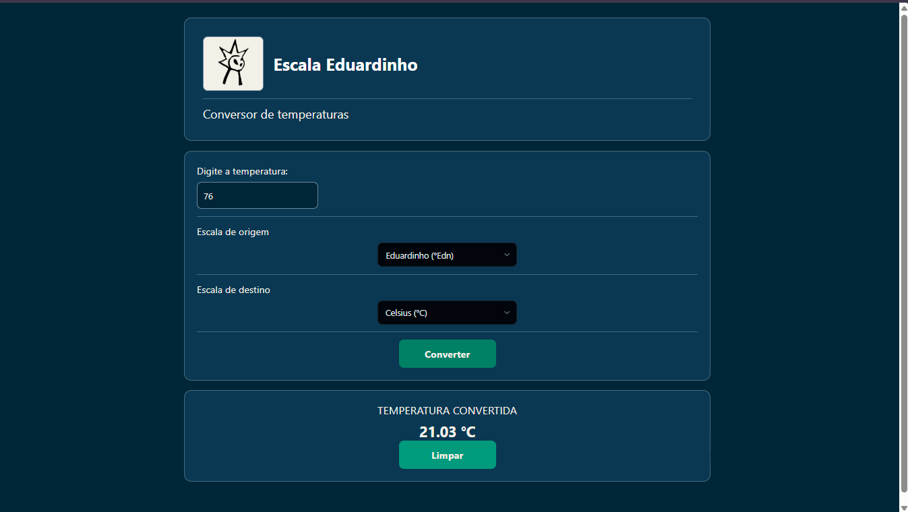
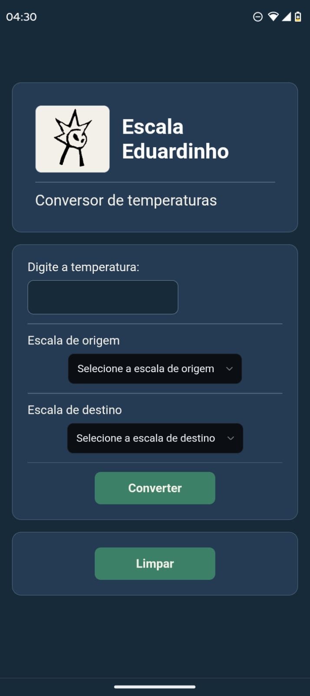

# Escala Eduardinho

**Conversor de temperaturas entre as escalas Eduardinho, Celsius, Fahrenheit e Kelvin.**

Uma aplicação desenvolvida com React Native e TypeScript que permite converter temperaturas entre quatro escalas, incluindo a escala autoral Eduardinho.

[**Acessar o aplicativo**](https://duardoguimaraes.github.io/escala-eduardinho/) · [**Consultar o código-fonte**](https://github.com/duardoguimaraes/escala-eduardinho)

## Sobre o projeto

O Escala Eduardinho é um projeto de desenvolvimento de software que combina a implementação de uma lógica de conversão de temperaturas com a criação de uma interface interativa e responsiva.

O diferencial é a inclusão da escala Eduardinho, com parâmetros próprios, integrada às escalas Celsius, Fahrenheit e Kelvin.

## Demonstração da aplicação

### Versão para computador



### Versão para celular


## Vídeo demonstrativo

## Vídeo demonstrativo

[](https://github.com/user-attachments/assets/7c776671-5be6-4486-8473-41e40e34e5a6)

## Identidade visual

O projeto conta com identidade visual própria, incluindo logo autoral desenvolvida pelo criador da escala Eduardinho, que representa o próprio Eduardinho.


## Acesse o aplicativo

[**Abrir Escala Eduardinho**](https://duardoguimaraes.github.io/escala-eduardinho/)

Disponível online e instalável como Progressive Web App (PWA) em dispositivos compatíveis.

## Funcionalidades

- Conversão entre quatro escalas de temperatura.
- Seleção independente das escalas de origem e destino.
- Entrada numérica de temperatura.
- Exibição do resultado com duas casas decimais.
- Conversão bidirecional entre as escalas.
- Limpeza dos campos para realizar novas operações.
- Interface responsiva para diferentes tamanhos de tela.
- Instalação como Progressive Web App (PWA).
- Funcionamento offline após o carregamento e armazenamento dos recursos necessários.

## Escalas de temperatura

A aplicação utiliza os seguintes valores de referência:

| Escala | Valor mínimo | Valor máximo |
|:--|--:|--:|
| Eduardinho (°Edn) | 35 | 230 |
| Celsius (°C) | 0 | 100 |
| Fahrenheit (°F) | 32 | 212 |
| Kelvin (K) | 273 | 373 |

A conversão utiliza uma fórmula de proporcionalidade baseada nos valores mínimos e máximos de cada escala.

## Tecnologias utilizadas

- **TypeScript** — implementação da lógica e tipagem.
- **React Native** — desenvolvimento da interface.
- **Expo** — ambiente de desenvolvimento e exportação.
- **React Native Web** — execução da interface no navegador.
- **Workbox** — geração do Service Worker e suporte offline.
- **Git e GitHub** — versionamento e hospedagem do código.
- **GitHub Pages** — publicação da aplicação.

## Estrutura do projeto

| Arquivo | Responsabilidade |
|:--|:--|
| `App.tsx` | Interface e componentes principais |
| `script.ts` | Lógica de conversão |
| `styles.ts` | Estilização da aplicação |
| `app.json` | Configurações do Expo |
| `public/` | Arquivos da aplicação web e configuração PWA |

## Executar localmente

É necessário ter Node.js e npm instalados.

**1. Clone o repositório:**

```bash
git clone https://github.com/duardoguimaraes/escala-eduardinho.git
```

**2. Entre na pasta:**

```bash
cd escala-eduardinho
```

**3. Instale as dependências:**

```bash
npm install
```

**4. Inicie a aplicação web:**

```bash
npm run web
```

## Progressive Web App (PWA)

O projeto também está disponível como PWA, permitindo sua instalação pelo navegador em dispositivos compatíveis.

A aplicação conta com manifesto, ícones próprios e Service Worker para armazenamento dos recursos necessários ao funcionamento offline.

## Direitos autorais

© 2026 Eduardo Guimarães. Todos os direitos reservados.

Este repositório não concede uma licença geral de código aberto. As bibliotecas e dependências de terceiros permanecem sujeitas às respectivas licenças.
